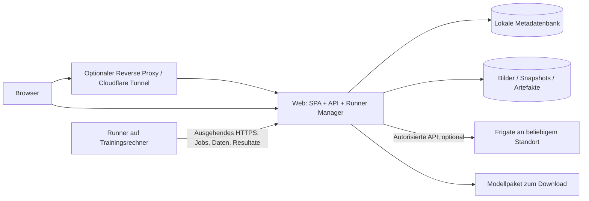

# Planentwurf: eigenes Modell-Trainingsportal

Stand: **23.10.2026**. Status: Diskussionsgrundlage mit Recherche und Roadmap.
Belegte Fakten stehen im [Rechercheprotokoll](../RESEARCH.md); nachfolgende
Architektur und Abnahmeziele sind Vorschläge. Keine Anwendung implementiert.

## 1. Ziel und erste Grenze

Ein Enthusiast soll eigene Frigate-Bilder sammeln, vollständig annotieren,
zusätzliche Objekte automatisch vorschlagen lassen, Fehler und manuelle
Negativbeispiele erfassen, ein eigenes Modell trainieren und ein geprüftes
Paket für seine Frigate-Zielhardware herunterladen können.

Erstes verbindlich zu erprobendes Profil: **YOLOv9-s ReLU6, 320×320,
INT8, Coral Edge TPU**. Coral ist das Inferenzziel; Training zunächst auf
Linux x86-64 mit NVIDIA-GPU. Diese Runner-Hardware ist mit dem Nutzer als
Planungsannahme abgestimmt, noch keine beschlossene Anschaffung.

„Alle Zielarchitekturen“ bedeutet ein erweiterbares System mit einer sichtbaren
Kompatibilitätsmatrix. Es bedeutet nicht, dass jeder Modelltyp ohne Anpassung
auf jedem Beschleuniger funktioniert. Modellfamilie, Aktivierung, Head,
Exportformat, Präzision, Frigate-Version und Hardware bilden gemeinsam ein
Profil. Neue Ziele werden erst nach ihrem eigenen Test als unterstützt markiert.

MVP: eine selbst gehostete Installation mit Administrator und optionalen
weiteren lokalen Bearbeitern; ein aktiver Trainingsjob pro Runner. Mehrere
Runner können registriert werden. Kein öffentliches Multi-Tenant-SaaS,
kein gemeinschaftlicher Datenupload, kein Kubernetes und kein verteiltes
Mehr-GPU-Training für die erste Version.

## 2. Bestehendes sinnvoll nutzen

Im lokalen Fork existieren Clean-Snapshots, Ereignismetadaten, Plus-Uploads,
ein YOLO-fähiger Coral-Detektor und React/Konva. Ein eigenständiges Portal
wurde hier nicht gefunden. Ein eventuell anderswo begonnener Ansatz wird
vor Implementierung abgeglichen.

Das Subprojekt wird nicht Teil des Frigate-Hauptprozesses. Kein Import von
Frigates Laufzeit, keine gemeinsame Datenbank und keine Pflicht, Frigate auf
demselben Host zu betreiben. Bestehende Detektoren dienen als Kompatibilitäts-
und Testreferenz. Die Plus-API wird nicht nachgebildet oder umgeleitet.

Separater Frigate-Connector liest autorisierte Ereignisse und saubere Bilder.
Später kann ein eigener „An Trainingsportal senden“-Knopf im Fork hinzukommen.
Manueller Upload und Bildimport funktionieren von Anfang an ohne Frigate.

## 3. Produktablauf aus den Referenzbildern

| Bereich | Geplantes Verhalten |
| --- | --- |
| Übersicht | Ungeprüfte Bilder je Kamera, Klassenverteilung, Tag/Nacht-Abdeckung, Negativbeispiele, aktive Jobs und Runnerzustand. |
| Bilder | Neu, ungeprüft, Vorschläge, Patches, alle; Filter nach Quelle/Kamera, Klasse, Datum, Qualität und Status. |
| Kameras | Portal-ID unabhängig von Frigate-Anzeigenamen; Quelle, Bildanzahl, Kameraposition/-generation. Umpositionierung nachvollziehbar. |
| Editor | Box erstellen, verschieben, skalieren, Klasse wählen, positiv/negativ, Zoom, Undo/Redo, Autosave-Status, Verifizieren separat. |
| Vorschläge | Weitere Objekte im gesamten Bild suchen, auch wenn die Einreichung nur eine Katze enthielt. Akzeptieren, korrigieren oder verwerfen. |
| Patches | Ausschnitte je Klasse/Status zum schnellen Auffinden von Fehlannotation und typischen Verwechslungen. |
| Datensätze | Unveränderlicher Snapshot, Klassenliste, Split, Herkunft, Qualitätsbericht; Änderungen erzeugen neue Version. |
| Training | Profil, Startgewichte, Datensatz, Parameter, Runner; Fortschritt, Kurven, Logs, Abbrechen, Checkpoints. |
| Modelle | Basis-/eigene Modelle, Trainingsläufe und Exporte getrennt; Genauigkeit, Hardwareprüfung, Labelmap, Download und Frigate-Konfiguration. |
| Runner | Pairing, Fähigkeiten, Versionen, GPU/RAM/Speicher, letzter Kontakt, aktuelle Arbeit, Drain und Widerruf. |

Rot plus durchgestrichene Klasse kennzeichnet ein negatives Beispiel;
Vorschläge erhalten einen eigenen Stil, verifizierte positive Boxen einen
weiteren. Farbe allein reicht nicht: Text, Muster oder Icon ergänzen den
Zustand. Tastaturbedienung orientiert sich an den Screenshots, bleibt außerhalb
von Texteingaben aktiv und hat eine sichtbare Hilfe.

„Speichern“ bedeutet Entwurf sichern. „Verifizieren“ bedeutet: Alle Objekte
der für diesen Datensatz aktiven Klassen wurden geprüft. Neue Vorschläge
überschreiben niemals manuelle Annotationen oder frühere Bestätigungen.

## 4. Negative Beispiele richtig definieren

Eine rote Box ist zuerst eine fachliche Annotation: „Diese Region ist kein
Objekt der Klasse X“. Sie darf manuell gezeichnet, geändert und gelöscht
werden, unabhängig von vorherigen Fehlalarmen. Quelle `manual` und Quelle
`frigate_false_positive` sind gleichwertig, aber nachvollziehbar gespeichert.

Das Standard-YOLO-Format kennt nur positive Objektboxen. Ein Export mit Klasse
`negative`, negativer Klassen-ID oder negativen Boxmaßen wäre fachlich falsch.
[Formatbeleg](https://docs.ultralytics.com/datasets/detect/).

Für den ersten Trainingsadapter gelten deshalb folgende Regeln:

1. **Vollständig geprüftes Hintergrundbild:** kein Objekt irgendeiner aktiven
   Zielklasse sichtbar. Export mit leerer Targetmenge; explizit als geprüft
   markiert. „Unannotiert“ wird niemals automatisch zu „Hintergrund“.
2. **Falsche Klasse bei echtem Objekt:** z. B. rote `cat`-Box auf einem Menschen.
   Die Person bekommt eine positive `person`-Box. Das vollständig annotierte
   Bild geht regulär ins Training. Die rote Box bleibt für Auswahl, Statistik
   und Evaluation erhalten; sie ist kein zusätzliches positives Target.
3. **Schwieriger Hintergrundbereich:** z. B. Busch als vermeintliche Katze.
   Negativbox darf Kontext-Crops und höher priorisierte Auswahl auslösen.
   Ein Crop wird nur verwendet, wenn sämtliche darin vorhandenen Objekte der
   aktiven Klassen korrekt übernommen und die Prüfung abgeschlossen sind.
4. **Nur klassenbezogen geprüft:** „keine Katze“ bei sonst unbekanntem Bildinhalt.
   Nicht als leeres Hintergrundbild exportieren. Prüfung vervollständigen
   oder aus dem Standardtraining ausschließen; im UI mit Grund sichtbar.
5. **Direkte klassenbezogene negative Loss:** spätere experimentelle Fähigkeit.
   Benötigt spezifizierte Zuordnung zu Kandidaten, Konfliktregeln und eigenen
   Vergleichstest. Nicht als Wirkung des MVP behaupten.

So wirken manuelle Negativbeispiele im MVP über geprüfte Trainingsbilder,
passende Kontextausschnitte und kontrolliertes Sampling. Die Negativregion
selbst ist zusätzlich ein lokales Testkriterium. Eine stärkere direkte Wirkung
braucht einen eigenen Trainingsadapter und Evidenz.

`difficult`, Verdeckung, außerhalb des Bildes und `ignore` getrennt speichern.
Ein Adapter muss diese Zustände explizit unterstützen oder das Bild mit
Begründung ausschließen. Einfaches Weglassen einer schwierigen positiven Box
würde sie fälschlich zu Hintergrund machen.

## 5. Zwei Container, unabhängig von Standort und Tunnel



Zwei **Anwendungsdienste und Image-Repositories**:

- `training-portal-web`: statischer React-Build, FastAPI, Authentisierung,
  Metadaten, Dateitransfer und langlebige Jobverwaltung. Keine CUDA-/Torch-
  Installation erforderlich. Ein API-Prozess als erster Betriebsmodus.
- `training-portal-runner`: Agent und feste, versionierte Trainings-/Export-
  Rezepte. Lädt Datensätze, trainiert, evaluiert und lädt Resultate zurück.
  Kein eingehender Port nötig; lokale Cache-/Arbeitsverzeichnisse persistent.

Innerhalb des Runner-Images getrennte Python-Umgebungen/Prozesse für Agent,
Torch und TensorFlow/Export, falls ihre Abhängigkeiten kollidieren. Keine
zusätzlichen Jobcontainer und kein Docker-Socket im MVP. Das sind getrennte
Umgebungen zur Kompatibilität, keine Sicherheitsgrenze gegen fremden Code.

Für spätere SDKs können **Varianten desselben Runner-Images** nötig werden.
Zwei Images heißen nicht, dass beliebige inkompatible SDKs in einem einzigen
Tag zusammen installiert werden können. Erste Referenz: Web auf Linux
amd64/arm64 erproben, Coral-Trainings-/Compiler-Runner auf Linux amd64.
Cloudflare-Tunnel, Frigate und spätere externe Datenbank sind optionale
Infrastruktur außerhalb der beiden Anwendungsdienste.

Frigate-Import benötigt eine erreichbare Verbindung **vom Web-Dienst zum
Frigate-Server**. Läuft Web außerhalb des Heimnetzes, muss diese Verbindung
konfiguriert oder ein expliziter Upload aus Frigate verwendet werden.
Die ausgehende Runner-Verbindung löst diese zweite Netzgrenze nicht automatisch.

## 6. Runner-Protokoll und belastbare Aufträge

Vorschlag: versionierte HTTP-API `/api/v1`, JSON-Verträge mit Pydantic/OpenAPI.
Runner holt Arbeit per kurz begrenztem Long-Polling ab; Browser erhält
Statusupdates über SSE oder Polling. Trainingsdauer ist keine Requestdauer.

Pairing: kurzlebiger Einmalcode, durch Administrator bestätigter Runner,
eigenes widerrufbares Token; Geheimnis serverseitig nur gehasht. Runner meldet
Architektur, verfügbare Rezepte, deren Versionen, Treiber/CUDA, GPU/VRAM,
freien Speicher und optionale Zielhardware. Unpassende Runner erhalten
keinen Job. Kontrollierte Parameter statt frei ausführbarer Shellbefehle.

Jobs: `queued → leased → running → succeeded | failed | cancelled`.
Pipeline-Stufen: Datenprüfung, Training, Evaluation, Export, Quantisierung,
Kompilierung, Artefaktprüfung. Zielhardwaretest ist ein eigenes Ergebnis und
kann fehlen, obwohl der Build erfolgreich war.

- Atomarer Claim mit `attempt_id`, Lease und Ablaufzeit; Heartbeat verlängert
  nur die aktuelle Lease. Wiederholte Requests sind idempotent.
- Bei Ausfall Lease auslaufen lassen, Versuch als unterbrochen markieren.
  Ein neuer Versuch darf alte Resultate nicht überschreiben: Attempt-/Lease-
  Token bei jedem Upload-Finalisieren prüfen.
- Neustart lädt Queue aus Datenbank. Kein reines In-Memory-BackgroundTask
  als verlässliche Jobverwaltung. Begrenzte Retries und verständliche Gründe.
- Checkpoints regelmäßig schreiben und hochladen. Resume nur, wenn Rezept,
  Dataset und Checkpoint zusammenpassen; nicht bitgenaue Wiederholung zusagen.
- Abbruch mit Frist, geordnetem Stop, danach Prozessgruppe beenden. Runner
  im Drain-Modus nimmt keine neue Arbeit, bestehender Job kann fertig werden.
- Cache nach SHA-256; Daten-/Artefaktübertragung blockweise mit Größenlimits,
  Fortsetzung und Prüfsumme. Z. B. 16-MiB-Blöcke als Startwert, später messen.

Cloudflare Access kann zusätzlich Service Tokens verlangen; diese sind von
unserer Runner-Identität getrennt. Kein Ablegen im Browser. Beschränkungen
für Requestgröße, Timeouts und Reconnects explizit in Deploymenttests prüfen.
[Service-Tokens](https://developers.cloudflare.com/cloudflare-one/access-controls/service-credentials/service-tokens/),
[Uploadlimits](https://developers.cloudflare.com/support/troubleshooting/http-status-codes/4xx-client-error/error-413/).

## 7. Datenmodell, Speicherung und Austausch

Erste Entitäten: `project`, `source`, `camera`, `image`, `annotation_revision`,
`annotation`, `verification`, `prediction_run`, `dataset_version`, `split_group`,
`training_run`, `job_attempt`, `runner`, `model_version`, `artifact`, `audit_event`.

Bild: Originaldatei, SHA-256, Maße, Aufnahmezeit, Quelle/Event-ID, Kamera und
deren Generation, gegebenenfalls Elternbild/Crop-Transformation. Boxen intern
in Originalpixeln als XYXY; alle Exporttransformationen explizit. EXIF-Drehung
beim Import konsistent normalisieren und dokumentieren. Kein Screenshot der
UI als Trainingsbild. Kameraeingebrannte Zeitstempel können trotz „clean“
vorhanden bleiben und werden als Dateneigenschaft berücksichtigt.

Annotation: Klasse aus versionierter Ontologie, Geometrie, Polarität,
Herkunft, Prüfstatus, Autor/Zeit und gegebenenfalls Vorschlagsmodell mit Score.
Negativannotation und akzeptierte Ground Truth sind getrennte Informationen.
Optimistische Versionsprüfung verhindert stilles Überschreiben durch zwei Tabs.

SQLite auf lokalem persistentem Volume für Metadaten und Queue. Dateien im
lokalen, inhaltsadressierten Blob-Verzeichnis, atomar finalisiert; keine Bilder
als große Datenbank-BLOBs. Nur Web greift auf die DB zu, Runner nur per API.
SQLite-WAL benötigt lokales Dateisystem. Einzelner Manager ist eine bewusste
erste Grenze. PostgreSQL/S3 als späterer Ausbau bei tatsächlichem Bedarf,
mit zusätzlicher Infrastruktur und Migrationstests.
[SQLite-WAL](https://www.sqlite.org/wal.html).

Snapshot enthält Bildhashes, Annotationsrevisionen, Klassen-/Labelmap,
Auswahlregeln, Samplinggewichte, Splitgruppen und Exportrezept. Seed und
Manifesthash erfassen. Neue aktive Klassen machen alte Prüfungen nicht
automatisch vollständig. Bereits erstellte Snapshots bleiben unverändert.

Austausch: COCO und YOLO für positive Boxen, zusätzlich eigenes JSON-Manifest
für Negativregionen, Reviewstatus, Herkunft und Transformationen. Ein
Standardexport muss seinen Informationsverlust nennen. Portal-Backup enthält
vollständige Metadaten und Dateien; Wiederherstellung wird getestet.

## 8. Vorannotation und Datenqualität

Vorannotation läuft als `predict`-Job auf dem Runner, auch unabhängig vom
späteren Trainingsmodell. Erste Quelle: freigegebenes öffentliches Modell
oder eigenes vorheriges Modell; Lizenz und Klassenabdeckung sichtbar.
Vollbild plus bei Bedarf überlappende Ausschnitte, Rücktransformation und
Deduplizierung. Auflösung/Schwelle des Vorschlagsmodells dürfen vom Coral-
Produktionsmodell abweichen. Vorschläge sind nie automatisch Ground Truth.

Bereits eingereichte Box plus zusätzliche Objekte mit Provenienz anzeigen.
Konflikte mit bestehenden Annotationen zum Prüfen markieren. Neue Vorhersagen
ersetzen keine manuelle Korrektur. Keine Vorschläge aus einem Modell für
Klassen versprechen, die dieses Modell nicht kennt. Neue Klassen zunächst
manuell; textgesteuerte Modelle als spätere lizenzgeprüfte Erweiterung.

Datensplits nach Ereignis/Clip/Zeitfenster und Duplikatgruppe, nicht zufällig
nach einzelnen benachbarten Frames. Abgeleitete Crops bleiben im Split des
Originals. Gegebenenfalls unabhängige Kamera-/Zeiträume für Generalisierung.
Train/Val/Test z. B. 70/15/15 als diskutierbarer Startwert, ohne bei seltenen
Klassen unbrauchbare Tests zu erzeugen. Keine starre Erfolgszusage aus Quote.

Trainingsdatenprüfung: beschädigte Bilder, leere/ungültige Boxen, doppelte
Bilder, Near-Duplicates, kleine/seltene Objekte, Kamera-/Tag-Nacht-Verteilung,
fehlende Klassen, unvollständige Prüfung und widersprüchliche positive/negative
Annotationen. Kalibrierungsbilder nur aus Trainings-/separatem Kalibrierpool,
repräsentativ für Licht, Kameras und tatsächliche Inferenz-Crops. Testdaten
bleiben aus Training, Kalibrierung und Hyperparameterauswahl heraus.

Eigene Kameradaten plus geeignete lizenzierte öffentliche Daten als Replay
gegen Vergessen erwägen. Nur lokales Fine-Tuning garantiert nicht den Erhalt
aller ursprünglichen Klassen. Klassenumfang des öffentlichen Modells ist
nicht identisch mit dem Plus-Angebot. Insbesondere Klassen außerhalb COCO
brauchen eigene Daten und passende Head-/Startgewicht-Behandlung.

## 9. Coral-Pipeline: zuerst den schwierigsten Teil beweisen

```text
Öffentliche zulässige Startgewichte + vollständig geprüfter Datensatz
 → YOLOv9-s ReLU6 Fine-Tuning
 → definierter Inferenz-Head: getrennte Klassenlogits und DFL-Boxdaten
 → statisches ONNX (Batch 1)
 → SavedModel über geprüften onnx2tf-Pfad
 → voll quantisiertes INT8-TFLite mit repräsentativen Daten
 → edgetpu_compiler unter Linux x86-64
 → Tensor-/Labelmap-/Numerikprüfung
 → realer Coral-Test mit Frigates Detektor und Leistungsbericht
```

Dieses Rezept ist ein belegter Ausgangspunkt aus den verlinkten Notebooks,
aber **noch nicht in dieser Umgebung reproduziert**. ReLU6 nicht erst nach
fertigem Training austauschen und identische Qualität erwarten. Logitbegrenzung,
DFL-Ausgabe, Quantisierungsskalen und Vorverarbeitung müssen konsistent sein.
[Trainingsreferenz](https://github.com/dbro/frigate-detector-edgetpu-yolo9/blob/main/notebooks/Fine_tune_YOLOv9_s_for_EdgeTPU_use_ReLU6_and_17_COCO_classes.ipynb),
[Exportreferenz](https://github.com/dbro/frigate-detector-edgetpu-yolo9/blob/main/notebooks/Convert_YOLO_v9_ReLU6_PyTorch_format_to_EdgeTPU_for_Google_Coral.ipynb).

Der vorhandene Frigate-Decoder erwartet besondere Outputs. Automatisch
prüfen: Tensorzahl/-form, quantisierte Datentypen, Scale/Zero-Point,
Klassenreihenfolge, RGB/NHWC, Eingabebereich und Verhalten auf Referenzbildern.
Ein-Klassen-Profile und genau 64 Klassen zunächst als inkompatibel sperren,
bis die lokale Formheuristik gezielt unterstützt und getestet ist. Auch
Mindestscore und maximale Detektionszahl des Forks gehören in die Prüfmatrix.

Vergleich über dieselben Bilder und dieselbe Decodierung: Torch → ONNX →
TFLite → Coral. Getrennt berichten: Genauigkeitsverlust, CPU-Fallback,
TPU-Zuordnung, Speicher, Aufwärmzeit und komplette Detektorzeit inklusive
CPU-Nachverarbeitung. Nicht nur Compiler-Erfolg oder reine TPU-Zeit anzeigen.

Coral-Test kann am Trainingsrechner mit eigener Coral erfolgen oder als
gezielter Test auf dem späteren Frigate-Host. Keine zweite Instanz gleichzeitig
auf dessen produktive Coral zugreifen lassen. Ohne reale Messung bleibt ein
Artefakt „kompiliert, Hardwareprüfung ausstehend“.

Falls reproduzierbarer eigener ReLU6-Trainingscheckpoint oder kompatible
Konvertierung scheitert, zuerst Ursache entscheiden: Rezept stabilisieren,
separates Basis-Fine-Tuning oder anderes Coral-Profil erproben. Nicht still
auf ONNX ausweichen und den Coral-Meilenstein als erledigt erklären.

## 10. Weitere Hardware als eigene Profile

| Ziel | Geplanter Pfad | Reihenfolge / Nachweis |
| --- | --- | --- |
| Coral Edge TPU | Angepasstes YOLOv9-s ReLU6 → INT8-TFLite → Compiler | Erste vollständige Pipeline, reale Coral-Abnahme. |
| ONNX Runtime CPU/CUDA | Passender ONNX-Inferenzgraph | Zweites Referenzprofil, Parität und Frigate-Decoder prüfen. |
| Intel CPU/GPU/NPU | Frigate-OpenVINO-kompatibles ONNX/IR | Eigenes Testgerät und Versionsmatrix. |
| NVIDIA TensorRT | Frigate-kompatibler ONNX-/TensorRT-Pfad | Engines auf passender Zielumgebung; Desktop/Jetson unterscheiden. |
| Rockchip | RKNN-Toolkit2, passender Head und Quantisierung | Eigenes Rezept, SoC-/Runtime-Prüfung. |
| Hailo | Modell-/SDK-spezifische Kompilierung | Zunächst Recherche zu SDK, Zugriff, Weitergabe und 8/8L/weiteren Geräten. |
| Weitere Frigate-Backends | Adapter für Modell, Format und Decoder | Erst nach dokumentierter Toolchain und eigener Abnahme. |

Ein Adapter beschreibt Fähigkeiten statt nur Dateiendungen: trainierbare
Familien, unterstützte Klassenanzahl, Exportziele, Präzision, Buildplattform,
Frigate-Versionen, Testhardware und Rezeptdigest. Training und Export sind
getrennte Jobs, damit ein Checkpoint mehrere passende Artefakte liefern kann.
Ein ONNX-Graph ist kein universell identischer Export für alle Backend-Heads.

## 11. Stack und Versionsstrategie

| Teil | Vorschlag | Begründung und Grenze |
| --- | --- | --- |
| Frontend | React 19.3, TypeScript, Vite 8.3; Konva/React-Konva nach Kompatibilitätsprüfung | Aktuelle dokumentierte React-/Vite-Linien, Nähe zum vorhandenen UI-Wissen. Eigener Build und eigenes Lockfile. |
| Web-API | FastAPI 0.156.4 als recherchierter Stand, Pydantic 2, unterstütztes Python | OpenAPI, validierte Verträge, Python-Ökosystem. Konkreten Python-/Patchstand beim Aufbau testen und fixieren. |
| Metadaten | SQLAlchemy 2.1, Alembic, SQLite | Einfache Zwei-Dienst-Installation; Migrations- und Queue-Tests erforderlich. |
| Runner-Agent | Python, HTTP-Client, strukturierte Logs | Kleiner stabiler Agent, getrennt von ML-Imports und Rezeptumgebungen. |
| Training | Original YOLOv9/PyTorch, freigegebenes Coral-Rezept | Konkrete kompatible Torch-/CUDA-Version durch Spike bestimmen, nicht blind neueste installieren. |
| Export | ONNX, onnx2tf, TensorFlow/LiteRT, Edge-TPU-Compiler | Legacy-Anteile gekapselt und separat versioniert. Neuer PyTorch-Exporter bevorzugt, sofern Gleichheit bewiesen. |
| Entwicklung | uv, Frontend-Lockfile, Ruff, pytest, Vitest, Playwright | Reproduzierbare Umgebungen und gezielte API-/Editor-/Ende-zu-Ende-Tests. |

Die genannten Webversionen wurden am 23.10.2026 offiziell dokumentiert:
[React](https://react.dev/versions), [Vite](https://vite.dev/releases),
[FastAPI](https://fastapi.tiangolo.com/release-notes/),
[SQLAlchemy](https://docs.sqlalchemy.org/en/21/).
Sie sind Kandidaten, kein getestetes gemeinsames Lockfile. Keine Migration
des bestehenden Frigate-Webs als Nebeneffekt.

Coral-Toolchain zunächst anhand der historischen Umgebung reproduzieren,
dann einzeln modernisieren und Ergebnisse vergleichen. Jede akzeptierte
Kombination erhält Rezeptversion, Commit-/Gewichthashes und Image-Digest.
Archive und Downloads prüfen, zulässige Bezugswege sichern, Upgrade-CI mit
Golden-Datensatz. Keine `latest`-Tags oder ungebundenen Git-Branches in
freigegebenen Rezepten. Moderne Portalversion und ältere Compilerabhängigkeit
können bewusst nebeneinander bestehen.

## 12. Sicherheit, Betrieb und Open Source

Portal besitzt eigene Anmeldung und Rollen (Administrator/Bearbeiter/Leser).
Sichere Sessions, CSRF-Schutz bei Cookie-Auth, Login-Limits und serverseitige
Projekt-/Bildrechte. Cloudflare schützt optional davor, ersetzt diese Rechte
aber nicht. OIDC später möglich; kein implizites Vertrauen in beliebige
Forwarded-/Identitätsheader.

Runner-Token pro Gerät, widerrufbar, nur zugewiesene Dateien und Resultate,
kein Zugriff auf übrige Projekte oder Frigate-Zugangsdaten. TLS prüfen;
lokales HTTP nur als ausdrückliche Entwicklungsoption. Logs ohne Tokens,
Signatur-URLs oder unnötige Bildinhalte.

Uploadprüfung: echte Bilddekodierung, Pixel-/Dateigrößenlimits, sichere
Archivextraktion, keine frei wählbaren Serverpfade. Frigate-Connector nur
für administrativ freigegebene Zielserver; SSRF/Redirects berücksichtigen.
Keine beliebigen Python-Pakete, Git-URLs oder Pickle-Checkpoints aus dem
Browser ausführen. Original-YOLO-Checkpoints nur aus freigegebenen Quellen;
unbekannter Checkpointimport ist eine separate Vertrauensentscheidung.

Backups von Datenbank und Blobbestand konsistent wiederherstellbar;
Aufbewahrung für Bilder, Checkpoints, Logs und Runnercache getrennt.
Löschung zeigt betroffene Snapshots/Modelle, entfernt auf Wunsch die Daten
auch aus Cache/Backups gemäß dokumentierter Aufbewahrung. Der historische
Manifesthash kann bleiben, gelöschte Bilddaten dürfen nicht erneut verteilt
werden. Ein Modell lässt sich durch Bildlöschung nicht rückwirkend entlernen.

Unabhängiger Projektname und eigene Gestaltung. Quellcode-Lizenz vor erster
Veröffentlichung festlegen; alle übernommenen Teile, Gewichte, Datensätze,
Compiler und SDKs separat mit Herkunft/Lizenz/Digest erfassen. Original
YOLOv9 ist GPL-3.0, nicht MIT; ein MIT-Portal macht mitgelieferte GPL-Teile
nicht MIT. Keine Lizenzumgehung durch Containertrennung annehmen.
Keine Plus-Gewichte als frei weitergebbare Trainingsbasis voraussetzen.

## 13. Qualität und auslieferbares Modellpaket

Ein freigegebenes Paket enthält Modell, Labelmap, Frigate-YAML für die
getestete Version, Manifest mit Hashes/Profil/Rezept, Trainings-/Dataset-ID,
Evaluationsbericht, Compilerreport und Hardware-Teststatus sowie Lizenzen.
Torch-Checkpoint separat zum Weitertrainieren aufbewahren. Ein kompiliertes
TFLite ist kein Ersatz für den ursprünglichen Trainingscheckpoint.

Metriken: mAP50 und mAP50–95, Precision/Recall je Klasse, seltene Klassen,
Tag/Nacht und kleine Objekte, Fehler auf bestätigten Negativregionen,
Quantisierungsverlust und p50/p95-Latenz inklusive Postprocessing.
Vergleich bei gleichen Schwellen und festen Testdaten. Zusätzlich positives
Recall prüfen, damit weniger Fehlalarme nicht nur verlorene Erkennungen sind.

Fehlalarme pro Stunde erfordern repräsentative Videolaufzeit und Frigates
Tracking-/Filterpipeline. Aus kuratierten Einzelbildern keine solche Rate
hochrechnen. Optional später ein expliziter Video-Replay-Test.

Vor dem ersten echten Vergleich gemeinsam numerische Toleranzen festlegen:
erlaubter Recall-/mAP-Verlust durch Quantisierung, maximale p95-Zeit auf
dem konkreten Host und gewünschte Verbesserung auf dem Negativ-Testset.
Keine erfundenen universellen Prozent- oder Millisekundengrenzen.

Abnahme des MVP: Ein eigener, verifizierter Datensatz ergibt ein trainiertes
Coral-Modell, das auf realer Hardware mit diesem Fork läuft; manuelle rote
Beispiele haben nachvollziehbaren Export-/Samplingeffekt; Zusatzobjekte
werden als überprüfbare Vorschläge gefunden; ein Runner kann über eine
getrennte Netzgrenze arbeiten und Ausfälle/Neustarts beschädigen weder
Datensatz noch Resultate. Ein Rückwechsel zum vorherigen Modell ist möglich.

## 14. Vorgeschlagene Modulgrenzen und Roadmap

Diese Capability Map wird vor einzelnen Modul-Spezifikationen besprochen.
Sie ist ein Vorschlag, keine bereits freigegebene Spec.

| Modul-ID | Verantwortung | Nutzt |
| --- | --- | --- |
| `artifact-store` | Dateien, Hashes, Transfer und Metadaten-/Auth-Grundlage | — |
| `dataset-review` | Bilder, Klassen, positive/negative Annotation, Verifizierung | `artifact-store` |
| `dataset-snapshots` | Versionen, Split, Qualitätsprüfung und Trainingsexport | `dataset-review` |
| `runner-control` | Pairing, Fähigkeiten, Jobversuche, Leases und Resultate | `artifact-store` |
| `prelabel` | Vorschlagsjobs, Modellprovenienz und Review | `dataset-review`, `runner-control` |
| `training-recipes` | Trainieren, evaluieren, quantisieren und kompilieren | `dataset-snapshots`, `runner-control` |
| `model-registry` | Artefaktbewertung, Vergleich, Download und Config | `training-recipes` |
| `frigate-connector` | Unabhängiger optionaler Importadapter | `dataset-review` |

Technischer Vorversuch **vor** Ausbau der Module: Coral-Rezept außerhalb der
Portal-UI durchspielen. Danach Reihenfolge entlang der Abhängigkeiten mit
vollständigen kleinen Benutzerwegen, nicht erst gesamte Datenbank und dann UI.

| Phase | Ergebnis / Gate |
| --- | --- |
| P0 – Machbarkeit | Herkunft/Lizenzen, öffentlicher Checkpoint → eigenes kurzes Fine-Tuning → Coral-Export → realer Detektortest. Neue Trainingsgewichte müssen getestet sein, nicht nur heruntergeladenes TFLite. |
| P1 – Datenerfassung | Zwei startbare Dienste; Bild hochladen, annotieren, rot markieren, verifizieren und verlustfrei exportieren; Snapshot/Split geprüft. |
| P2 – Remote-Arbeit | Runner pairen, Fähigkeiten prüfen, Predict-Job über HTTPS; zusätzliche Objekte im Editor prüfen. Transfer-/Lease-/Neustarttests. |
| P3 – Erstes eigenes Modell | Snapshot trainieren, Kurven/Checkpoints/Abbruch; Export-/Quantisierungsbericht und Modellpaket. |
| P4 – Praktischer Betrieb | Optionaler Frigate-Import, Patches, gezieltes Sampling, Modellvergleich, Backup/Restore, Tunneltest und dokumentierter Rückwechsel. |
| P5 – Weitere Ziele | ONNX als zweites Profil, dann OpenVINO/TensorRT und nach Hardwarebedarf RKNN/Hailo/weitere. Jedes Ziel mit eigener Abnahme. |

Geschätzte Planungseinheiten sind keine zugesagten Laufzeiten. P0 entscheidet
über den größten Unsicherheitsblock. Erst danach Aufwand und Hardwarebedarf
auf echten Messungen schätzen. Detaillierung der nächsten kleinen Schritte:
[vorläufige Aufgaben](todo.md).

## 15. Noch gemeinsam festzulegen

1. **Erster Klassenumfang:** öffentliche 17-Klassen-Referenz als schneller
   technischer Start oder direkt eigene Klassenliste? Empfehlung: Referenz
   für P0; anschließend gewünschte Tier-/Objektklassen mit Datenbedarf planen.
2. **Basisgewichte:** öffentliche Startgewichte und Herkunft der eventuellen
   zusätzlichen Replaydaten; eigene neue Klassen nicht aus Plus ableiten.
3. **Frigate-Kompatibilität:** zunächst dieser konkrete Fork, daneben welcher
   stabile Upstream-Release als Referenz? `dev` nicht pauschal versprechen.
4. **Negativtraining:** MVP mit vollständig geprüften Bildern und Sampling
   ausreichend oder direkte klassenbezogene negative Loss zwingend für v1?
5. **Betriebsgröße:** grobe Bildzahl, Speicherbudget und Zahl gleichzeitiger
   Bearbeiter für erste Messungen. Keine notwendige Hürde für P0.
6. **Produktname/Lizenz und spätere Mitwirkung:** unabhängiger Name,
   Datenweitergabe standardmäßig ausgeschaltet, Supportprofile sichtbar.

Nächste gemeinsame Vertiefung: Modulgrenzen und P0-Kriterien besprechen,
danach die erste begrenzte technische Spezifikation ausarbeiten. Dieser
Planungsauftrag schließt noch keine Implementierung oder Veröffentlichung ein.
